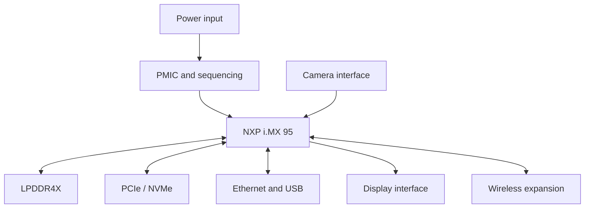

# FlexSoC — IMAX95 modular compute platform

Independent engineering research by MD Anaet Ullah. The current development focus is a custom NXP i.MX 95 compute platform and modular carrier architecture.

**Status: design in progress; not a validated or production-ready board.**

## Current design direction

| Subsystem | Proposed architecture |
|---|---|
| Processor | NXP i.MX 95 (MIMX9596 family) |
| Memory | LPDDR4X; Samsung K4UBE3D4AA/AB-MGCL under evaluation |
| Power | PMIC and sequencer architecture; rail budget and startup validation pending |
| Storage | PCIe/NVMe M.2; boot storage under evaluation |
| Connectivity | Ethernet, USB-C, M.2 wireless expansion |
| Displays | MIPI DSI, LVDS/eDP bridge options under evaluation |
| Cameras | MIPI CSI-2 |
| Audio | Audio codec and amplifier architecture under evaluation |
| Software | Linux BSP and board-specific device tree planned |

Memory capacity, pin mapping, compatibility and power sequencing require confirmation against manufacturer documentation. No CM5 electrical or mechanical compatibility is claimed.

## Architecture

## Development roadmap

- [ ] Freeze processor and memory configuration.
- [ ] Verify every power domain and startup sequence.
- [ ] Complete schematic and resolve ERC findings.
- [ ] Define PCB stackup, impedance targets and DDR constraints.
- [ ] Complete placement, routing and DRC review.
- [ ] Review fabrication and assembly documentation.
- [ ] Prototype bring-up: power, clocks, reset, boot and memory.
- [ ] Validate interfaces, thermal behavior and EMC.

## Repository structure

- hardware/ — hardware design material
- firmware/ — firmware development
- software/ — software and BSP development
- mechanical/ — mechanical integration
- docs/ — design documentation
- tests/ — validation material

The original FlexSoC concept also explored replaceable MCU and FPGA compute modules. Carrier pinout and backward compatibility remain design goals rather than validated specifications.

## Tools and references

KiCad, Altium Designer, LTspice, Python and NXP's i.MX Linux documentation.

## Collaboration

Technical feedback and component evaluation support are welcome. Manufacturer names identify proposed components; they do not imply sponsorship, endorsement or certification.

Licensing is pending clarification. Do not assume an open-source license until a valid license is published.

[Engineering portfolio](https://jewel3g.github.io)
